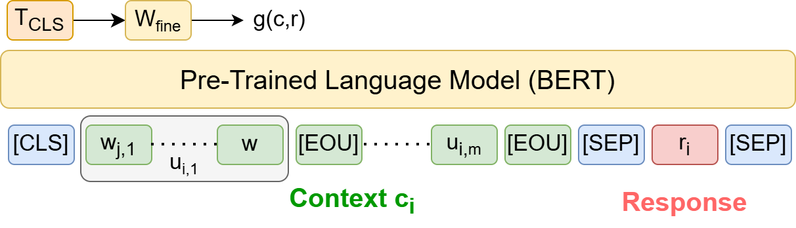
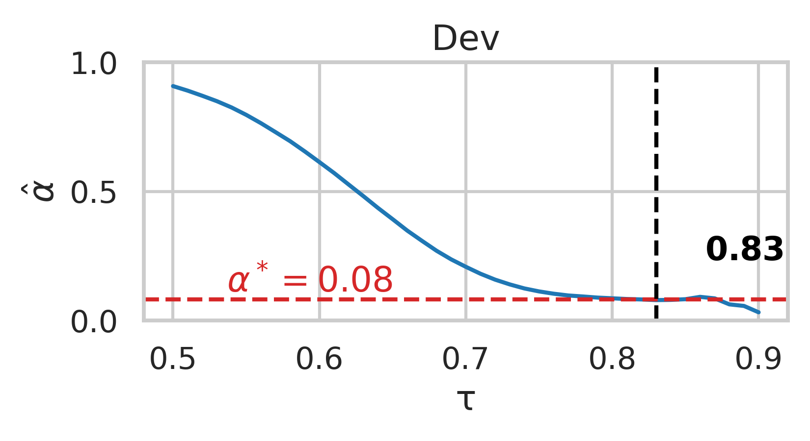
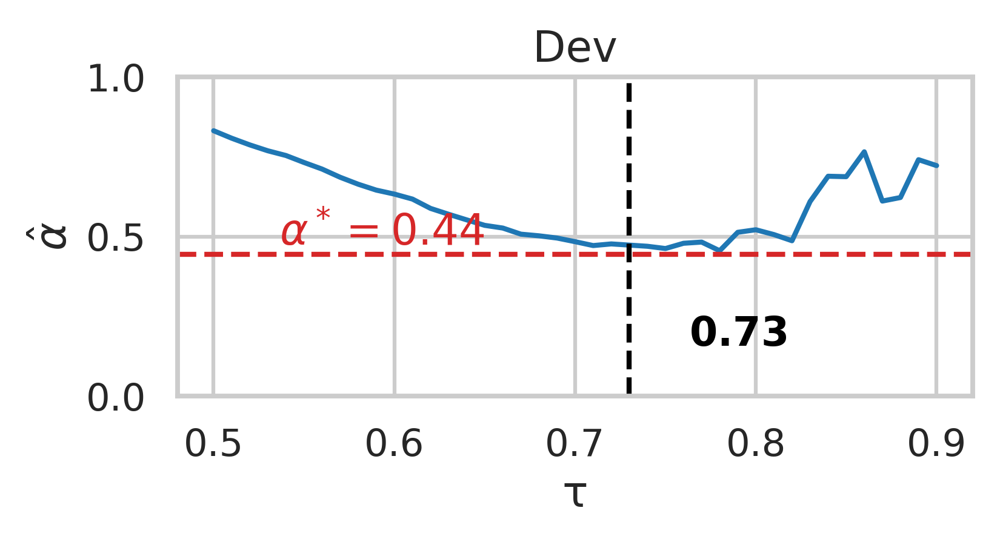
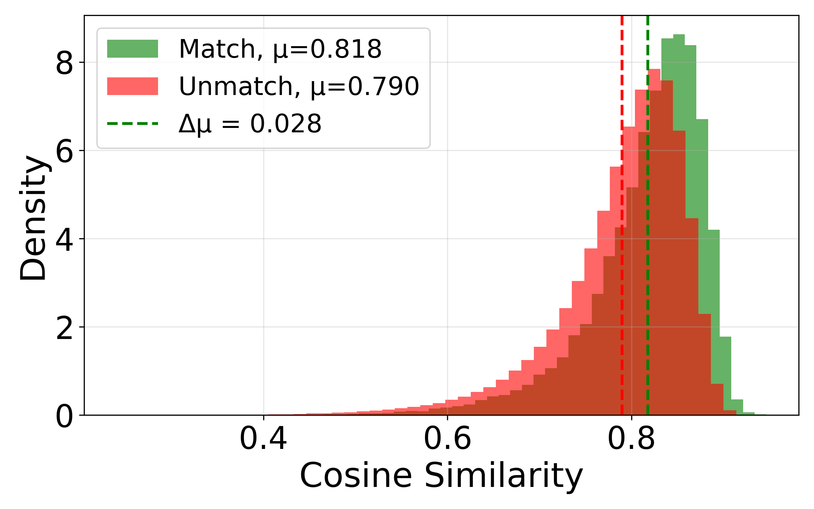
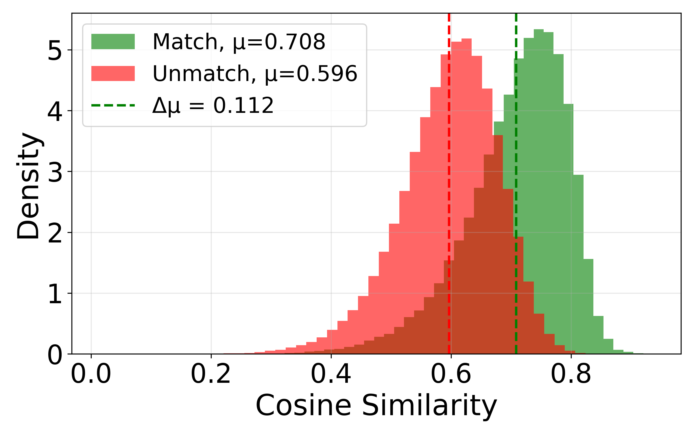

# Positive-Unlabeled Learning for Response Selection

Reference implementation for the paper *Positive-Unlabeled Learning for Response Selection*.

Response selection is cast as a Positive-Unlabeled (PU) problem: only a fraction of the matching
context-response pairs is labeled, and everything else, including all true negatives, is unlabeled.
The repository covers the full PU pipeline on top of BERT-FP, plus a lightweight class prior
estimator that reads the cosine similarities of the post-trained encoder and needs no labeled
negatives and no second model.



The context and response are encoded as one sequence; the final `[CLS]` state is scored by a linear
layer. Post-training and fine-tuning both run on this backbone.

## The PU ratio

Throughout the code the flag is `--rPU`, the fraction of positives *hidden* in the unlabeled pool.
The paper reports the labeled fraction `β = N_L / N_D` instead. On the 1:1 training sets of both
corpora the two are related by `β = (1 - rPU) / 2`, so the paper's `β = 10%` setting corresponds to
`--rPU 0.8`: 100K labeled positives and 900K unlabeled pairs out of 1M, and an exact class prior
`α* = 0.444`.

## Setup

Python 3.10 or newer, and one CUDA GPU with at least 40GB for the full runs.

```bash
python -m venv .venv && source .venv/bin/activate
pip install torch torchvision --index-url https://download.pytorch.org/whl/cu121
pip install -r requirements.txt
```

Then follow `data/README.md` to download the Ubuntu and E-Commerce corpora and build the pickles.
All commands below are run from the repository root.

## Reproducing the experiments

### 1. PU post-training

```bash
scripts/post_train.sh ubuntu 0.8
scripts/post_train.sh e_commerce 0.8
```

Writes one checkpoint per epoch under `FPT/PT_checkpoint/positive_only/<task>/checkpoint<n>/`. The
later stages read epoch 25 for Ubuntu and epoch 34 for E-Commerce, matching the BERT-FP schedule.

### 2. PU fine-tuning

```bash
scripts/finetune.sh ubuntu pos_neg_finetune  0.8   # PU_PT+FT with alpha = 0
scripts/finetune.sh ubuntu statistical_prior 0.8   # PU_PT+FT with alpha = alpha*
```

`pos_neg_finetune` treats every unlabeled pair as a negative, which is the PU loss with `α = 0`.
`statistical_prior` computes the exact prior `α*` from the label counts and plugs it into the PU
loss. Both scripts train, then evaluate R@1, R@2 and R@5 on the test set.

Running `statistical_prior` with `--rPU` omitted gives the fully supervised cross-entropy baseline,
but it then loads Han et al.'s released BERT-FP checkpoint from
`FPT/PT_checkpoint/original/<task><n>/bert.pt` rather than a checkpoint produced here.

### 3. Our class prior estimator

```bash
scripts/estimate_prior.sh ubuntu 0.8
```

This runs two steps per split. First it extracts the mean-pooled context and response embeddings
from the post-trained encoder and caches their cosine similarities as
`prior_map_cosine_rPU0.8[_dev].json`. Then it sweeps `τ` over `{0.50, ..., 0.90}`, computes the tail
ratio `α̂(τ)`, picks `τ*` as the centre of the lowest-variance window of 5 consecutive grid points,
and writes `results/pi_hat_vs_tau_<split>_<task>_rPU0.8.png`.

The estimate printed for the train split is the one reported for our estimator below.

| Ubuntu (dev) | E-Commerce (dev) |
| --- | --- |
|  |  |

`α̂(τ)` falls from near 1, flattens onto a plateau around the true `α*` (red), then goes noisy once
the tail empties. The selected `τ*` (black) lands inside that plateau on both corpora.

### 4. Baseline estimators

```bash
scripts/baseline_estimators.sh ubuntu 0.8
```

Fine-tunes a positive-versus-unlabeled classifier on top of the post-trained encoder and applies EN,
Scott, BBE and DedPU to its output scores. Estimates are appended to
`PvU/pvu_checkpoint/<task>_rPU0.8_new/{train,dev}_estimate_alpha.csv`, with `α*` recorded in
`true_alpha.csv` for reference.

### 5. Similarity distributions

```bash
scripts/plot_similarities.sh ubuntu 0.8
```

| Zero-shot | Post-trained |
| --- | --- |
|  |  |

Post-training pulls matched and unmatched pairs apart on Ubuntu, from `Δμ = 0.028` to `Δμ = 0.112`.
That separation is what makes the tail-ratio estimator work. Output goes to
`results/density/cosine_similarity/`.

## Reported results

Response selection under `β = 10%`, for orientation when re-running:

| Setting | Ubuntu R@1 | Ubuntu R@2 | Ubuntu R@5 | E-Commerce R@1 | E-Commerce R@2 | E-Commerce R@5 |
| --- | --- | --- | --- | --- | --- | --- |
| Fully supervised (Han et al.) | 0.911 | 0.962 | 0.994 | 0.870 | 0.956 | 0.993 |
| PU post-training + supervised fine-tuning | 0.877 | 0.941 | 0.988 | 0.775 | 0.913 | 0.987 |
| Fully PU, `α = 0` | 0.813 | 0.909 | 0.975 | 0.544 | 0.765 | 0.954 |
| Fully PU, `α = α*` | 0.824 | 0.918 | 0.981 | 0.667 | 0.852 | 0.972 |

Class prior estimates against `α* = 0.444` on both corpora:

| Estimator | Ubuntu α̂ | Ubuntu abs. dev. | E-Commerce α̂ | E-Commerce abs. dev. |
| --- | --- | --- | --- | --- |
| EN | 0.547 | 0.103 | 0.423 | 0.021 |
| Scott | 0.236 | 0.208 | 0.507 | 0.063 |
| BBE | 0.356 | 0.088 | 0.471 | 0.027 |
| Ours | 0.435 | 0.009 | 0.459 | 0.015 |

## Attribution

Built on [BERT-FP](https://github.com/hanjanghoon/BERT_FP) (Han et al., NAACL 2021). The
mixture-proportion-estimation baselines come from
[acmi-lab/PU_learning](https://github.com/acmi-lab/PU_learning) (Garg et al., NeurIPS 2021), which
is Apache-2.0 licensed. See `NOTICE` for details, and `LICENSE` for the license text.
